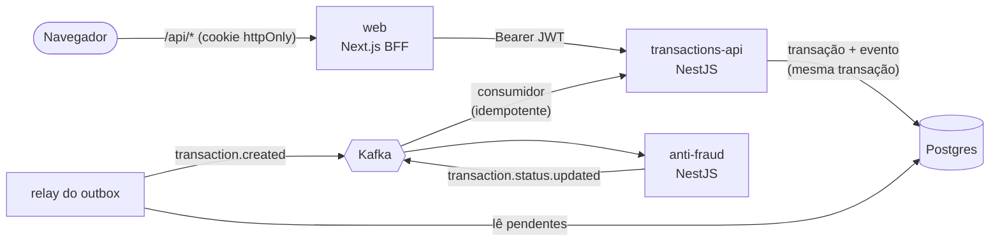

# Transações com validação antifraude

Sistema de transações financeiras orientado a eventos. Uma API recebe as transações, que
nascem **pendentes**; um serviço antifraude as avalia de forma assíncrona via Kafka
(**acima de 1000 → rejeitada**, as demais **aprovadas**) e o resultado atualiza o status. Um
dashboard lista, filtra, detalha e cria transações, e mostra a mudança de status sem
recarregar a página.

As escolhas de arquitetura, as alternativas consideradas e os motivos de cada uma estão no
[`DECISIONS.md`](./DECISIONS.md), incluindo a resposta sobre volume alto de escritas e
leituras concorrentes.

- [Arquitetura](#arquitetura)
- [Rodando tudo com Docker](#rodando-tudo-com-docker)
- [Desenvolvimento local](#desenvolvimento-local)
- [API](#api)
- [Testes e quality gate](#testes-e-quality-gate)
- [Estrutura do repositório](#estrutura-do-repositório)
- [Fluxo de trabalho](#fluxo-de-trabalho)
- [O que ficou de fora](#o-que-ficou-de-fora)

## Arquitetura



| Peça                    | Responsabilidade                                                                                                |
| ----------------------- | --------------------------------------------------------------------------------------------------------------- |
| `apps/transactions-api` | Cria, consulta e lista transações; grava o evento no outbox; consome o resultado do antifraude; autentica (JWT) |
| `apps/anti-fraud`       | Consome `transaction.created`, aplica a regra e publica `transaction.status.updated`                            |
| `apps/web`              | Dashboard (listagem com filtros, detalhe, criação, login) e BFF que encaminha `/api/*` para a API               |
| `apps/e2e`              | Testes ponta a ponta com Playwright contra a stack em containers                                                |
| `packages/contracts`    | Schemas zod de entrada, resposta e eventos, compartilhados pelos três apps                                      |
| `packages/messaging`    | Publisher Kafka, criação de tópicos, dead letter e retry com backoff                                            |
| `packages/config`       | TypeScript e ESLint compartilhados                                                                              |

**Garantias do fluxo assíncrono**

- **Sem evento perdido:** a transação e o evento são gravados juntos (outbox). Se o Kafka
  estiver fora, a API continua aceitando transações e os eventos saem quando ele voltar.
- **Entrega pelo menos uma vez, efeito exatamente uma vez:** o status só muda de
  `pending` para o resultado, então um evento repetido não tem efeito.
- **Mensagem inválida não trava o consumo:** vai para `<tópico>.dlq` com o motivo e o
  conteúdo original.
- **Ordem por transação:** a chave da mensagem é o id da transação.

**Stack:** Node.js 22, pnpm 12 (workspaces) + Turborepo, NestJS 12, Prisma 7, PostgreSQL 16,
Kafka (KRaft), Next.js 16 + React 19 + Tailwind 4 + TanStack Query, zod 4, Vitest,
Testing Library + MSW, Testcontainers e Playwright.

## Rodando tudo com Docker

Pré-requisito: Docker com Compose v2.

```bash
cp .env.example .env
docker compose up -d --build --wait
```

Abra **http://localhost:3000** e entre com o usuário de demonstração:

| E-mail               | Senha       |
| -------------------- | ----------- |
| `demo@desafio.local` | `demo12345` |

Crie uma transação de 500 e outra de 1500: as duas nascem **Pendente** e, segundos depois,
viram **Aprovada** e **Rejeitada** na própria tela.

| Serviço             | Endereço                     |
| ------------------- | ---------------------------- |
| Dashboard           | http://localhost:3000        |
| API de transações   | http://localhost:3001        |
| Antifraude (health) | http://localhost:3002/health |
| Kafka UI            | http://localhost:8080        |
| Postgres            | `localhost:5432`             |
| Kafka               | `localhost:9092`             |

> **Porta ocupada?** Todas as portas do host vêm do `.env` (`WEB_PORT`, `TRANSACTIONS_PORT`,
> `ANTI_FRAUD_PORT`, `POSTGRES_PORT`, `KAFKA_PORT`, `KAFKA_UI_PORT`). Ao trocar
> `POSTGRES_PORT` ou `KAFKA_PORT`, ajuste também `DATABASE_URL` e `KAFKA_BROKERS`.

Para parar: `docker compose down` (com `-v` apaga também os dados).

## Desenvolvimento local

Pré-requisitos: Node.js 22 (há um `.nvmrc`) e pnpm via Corepack.

```bash
nvm use
corepack enable
pnpm install

cp .env.example .env
docker compose up -d --wait postgres kafka kafka-ui   # só a infraestrutura

pnpm --filter @tech-challenge/transactions-api prisma:migrate
pnpm dev                                               # API, antifraude e dashboard em watch
```

O `.env` da raiz é lido pelos três apps. A API cria o usuário de demonstração
(`DEMO_USER_EMAIL`/`DEMO_USER_PASSWORD`) na subida.

### Variáveis de ambiente

| Variável                                            | Para que serve                                                                       |
| --------------------------------------------------- | ------------------------------------------------------------------------------------ |
| `POSTGRES_USER`, `POSTGRES_PASSWORD`, `POSTGRES_DB` | Credenciais e nome do banco                                                          |
| `POSTGRES_PORT`, `DATABASE_URL`                     | Porta do Postgres no host e URL de conexão (as duas precisam concordar)              |
| `KAFKA_PORT`, `KAFKA_BROKERS`                       | Porta do Kafka no host e endereço usado pelos apps (as duas precisam concordar)      |
| `KAFKA_CLIENT_ID`, `KAFKA_GROUP_ID_*`               | Identificação do cliente e grupos de consumo                                         |
| `TRANSACTIONS_PORT`, `ANTI_FRAUD_PORT`, `WEB_PORT`  | Portas da API, do antifraude e do dashboard                                          |
| `WEB_ORIGIN`                                        | Origem do dashboard autorizada a chamar a API (CORS)                                 |
| `TRANSACTIONS_API_URL`                              | Endereço da API usado pelo servidor do Next (o navegador fala só com o Next, `/api`) |
| `JWT_SECRET`, `JWT_EXPIRES_IN_SECONDS`              | Segredo de assinatura do JWT (HS256, mínimo de 32 caracteres) e validade do token    |
| `DEMO_USER_EMAIL`, `DEMO_USER_PASSWORD`             | Usuário criado na subida da API                                                      |

O `JWT_SECRET` do exemplo serve só para desenvolvimento. Para gerar um:

```bash
node -e "console.log(require('crypto').randomBytes(48).toString('base64url'))"
```

Para criar uma migration depois de alterar `apps/transactions-api/prisma/schema.prisma`:

```bash
pnpm --filter @tech-challenge/transactions-api prisma:migrate:dev --name descricao-da-mudanca
```

## API

Todas as rotas exigem `Authorization: Bearer <token>`, exceto o login e o health.

| Método | Rota                                   | Descrição                                                                                               |
| ------ | -------------------------------------- | ------------------------------------------------------------------------------------------------------- |
| `POST` | `/auth/login`                          | `{ email, password }` → `{ accessToken, expiresIn }`                                                    |
| `POST` | `/transactions`                        | Cria uma transação (status `pending`)                                                                   |
| `GET`  | `/transactions/:transactionExternalId` | Consulta uma transação                                                                                  |
| `GET`  | `/transactions`                        | Lista com `page`, `pageSize` (≤ 100), `status`, `transferTypeId`, `createdFrom`, `createdTo` (ISO 8601) |
| `GET`  | `/transfer-types`                      | Tipos de transferência (Pix, TED, Boleto)                                                               |
| `GET`  | `/health`                              | Saúde da API e do banco                                                                                 |

```bash
TOKEN=$(curl -s -XPOST localhost:3001/auth/login -H 'content-type: application/json' \
  -d '{"email":"demo@desafio.local","password":"demo12345"}' | jq -r .accessToken)

curl -s -XPOST localhost:3001/transactions \
  -H "authorization: Bearer $TOKEN" -H 'content-type: application/json' \
  -d '{"accountExternalIdDebit":"3fa85f64-5717-4562-b3fc-2c963f66afa6",
       "accountExternalIdCredit":"9c1b6f3e-2a4d-4e8b-9f7a-1d2c3b4a5e6f",
       "transferTypeId":1,"value":120}'
```

```json
{
  "transactionExternalId": "01a12c49-2a9b-7529-b23c-05f14ddd4710",
  "transactionType": { "id": 1, "name": "Pix" },
  "transactionStatus": { "name": "pending" },
  "value": 120,
  "createdAt": "2026-10-11T18:45:54.971Z"
}
```

Erros de validação voltam por campo:
`{ "statusCode": 400, "message": "Dados inválidos", "errors": { "value": ["O valor deve ser maior que zero"] } }`.

**Eventos** (envelope `{ eventId, type, version, occurredAt, payload }`, chave = id da
transação):

| Tópico                       | Payload                                                       | Publicado por                              |
| ---------------------------- | ------------------------------------------------------------- | ------------------------------------------ |
| `transaction.created`        | `{ transactionExternalId, value }`                            | transactions-api (outbox)                  |
| `transaction.status.updated` | `{ transactionExternalId, status: "approved" \| "rejected" }` | anti-fraud                                 |
| `*.dlq`                      | `{ reason, failedAt, originalValue }`                         | consumidor que recebeu a mensagem inválida |

## Testes e quality gate

```bash
pnpm quality
```

Roda, nesta ordem: formatação, lint, checagem de tipos, testes unitários e de componente,
testes de integração, build e, por último, os testes ponta a ponta. É o mesmo comando do
CI (GitHub Actions). Cada etapa também roda isolada:

| Comando                             | O que faz                                                                    | Precisa de Docker |
| ----------------------------------- | ---------------------------------------------------------------------------- | ----------------- |
| `pnpm format:check` / `pnpm format` | Prettier                                                                     | não               |
| `pnpm lint`                         | ESLint com informação de tipos                                               | não               |
| `pnpm typecheck`                    | `tsc --noEmit` em todos os pacotes                                           | não               |
| `pnpm test`                         | Unidade, HTTP (supertest) e telas (Testing Library + MSW)                    | não               |
| `pnpm test:integration`             | Postgres e Kafka reais via Testcontainers                                    | sim               |
| `pnpm build`                        | Build de todos os apps                                                       | não               |
| `pnpm test:e2e`                     | Sobe a stack num projeto compose isolado (portas 13000+) e roda o Playwright | sim               |

O e2e sobe sua própria cópia da stack (`tech-challenge-e2e`), então pode rodar com o
ambiente de desenvolvimento no ar. Para testar um ambiente que já está rodando:
`E2E_BASE_URL=http://localhost:3000 pnpm --filter @tech-challenge/e2e test:e2e`.

**O que cada camada cobre**

- **Unidade:** limite de 1000 (aprovado em 1000, rejeitado em 1000,01), validação dos
  contratos, idempotência da atualização de status, dead letter, hash de senha e login.
- **HTTP:** status e formato das respostas, erros por campo, rotas protegidas.
- **Telas:** carregamento, erro com nova tentativa, vazio, filtros na URL, paginação,
  atualização de pendentes, validação do formulário e do login. As consultas usam papéis
  acessíveis (`getByRole`).
- **Integração:** migrations reais, atomicidade do outbox, `CHECK` do banco, relay com o
  Kafka fora, dois relays concorrentes sem duplicar evento, retenção do outbox e fluxo HTTP
  → Kafka → status.
- **Ponta a ponta:** login, criação pelo dashboard e status mudando na tela sem recarregar.

Os hooks de git rodam ESLint e Prettier nos arquivos alterados (pre-commit) e validam
Conventional Commits (commit-msg).

## Estrutura do repositório

```
apps/
  transactions-api/   NestJS: HTTP, outbox, consumidor de status, autenticação
    prisma/           schema e migrations versionadas
    test/             testes HTTP e de integração (Testcontainers)
  anti-fraud/         NestJS: consumidor de transaction.created e regra
  web/                Next.js: dashboard e BFF (/api/*)
  e2e/                Playwright + script que sobe a stack isolada
packages/
  contracts/          schemas zod (API, formulário e eventos)
  messaging/          integração com o Kafka
  config/             tsconfig e ESLint compartilhados
DECISIONS.md          decisões de arquitetura
docker-compose.yml    infraestrutura e aplicações
```

## Fluxo de trabalho

- O trabalho sai de `develop` em branches `tipo/descricao` (`feat/autenticacao`,
  `build/docker-e2e`…) e volta por pull request, com o template preenchido.
- Commits pequenos seguindo Conventional Commits, validados no hook de `commit-msg`.
- O CI roda `pnpm quality` em todo push e pull request.

## O que ficou de fora

Ficou de fora de propósito, por prazo ou por não ser exigido. Cada item tem o caminho
descrito no `DECISIONS.md`.

- **Gestão de usuários:** não há cadastro, recuperação de senha, papéis nem refresh token.
  Existe só o usuário de demonstração, e a sessão expira em 1h.
- **Revogação de token:** o JWT é stateless; o logout apaga o cookie, mas um token copiado
  continua válido até expirar.
- **Rate limiting:** não há limite de tentativas no login nem na API.
- **Cliente Kafka mantido:** o `kafkajs` está sem releases desde 2023. A troca pelo
  `@confluentinc/kafka-javascript` ficaria concentrada no pacote `messaging`.
- **Escala:** paginação por cursor, réplicas de leitura, cache das transações resolvidas,
  consumo em lote, CDC no outbox e SSE no lugar do polling estão descritos, não
  implementados.
- **Idempotência na criação:** não há `Idempotency-Key` em `POST /transactions`; um retry
  do cliente cria outra transação.
- **Observabilidade:** logs em texto, sem métricas, tracing distribuído nem alertas de lag
  do consumidor ou de DLQ.
- **Produção:** o compose é para desenvolvimento e e2e (Kafka com um broker, sem
  replicação nem TLS). Não há manifesto de deploy nem gestão de segredos.
